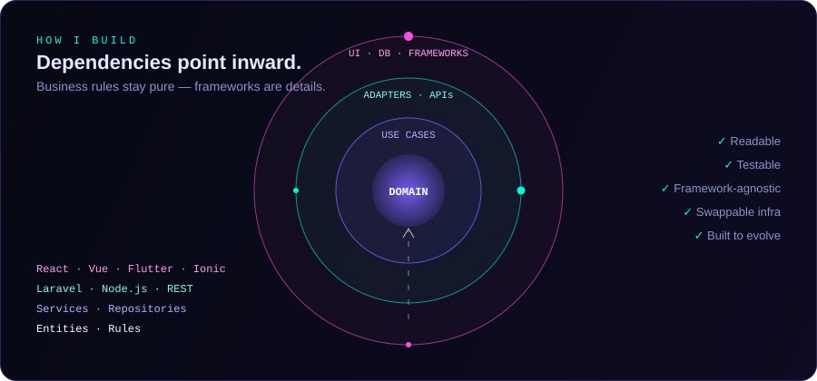

 

 

 

## ⚡ `whoami`

  

 

<table>
<tr>
<td width="50%" valign="top">

### 🎯 What I do

- 🧱 **Full Stack** — frontend, backend & mobile, end to end
- 🧠 **Clean Architecture**, SOLID & design patterns by default
- 🔌 **APIs & scalable systems** that survive real traffic
- 📱 **Mobile apps** with Flutter & Ionic
- 📈 **Product mindset** — performance, maintainability, clarity

</td>
<td width="50%" valign="top">

### 🚀 Open to

- 🌍 Full-time or contract — **remote or international**
- 💼 Freelance projects
- 🤝 Technical collaborations
- 🛠️ Building digital products **from scratch**

> 🎓 Degree in **Systems Analysis and Development**

</td>
</tr>
</table>

 

## 🏛️ Engineering philosophy

  

 

## 🧩 Tech arsenal

<table>
<tr>
<td align="center" width="25%"><b>🎨 Frontend</b></td>
<td align="center" width="25%"><b>⚙️ Backend</b></td>
<td align="center" width="25%"><b>📱 Mobile</b></td>
<td align="center" width="25%"><b>🐳 DevOps & Tools</b></td>
</tr>
<tr>
<td align="center"></td>
<td align="center"></td>
<td align="center"></td>
<td align="center"></td>
</tr>
</table>

 

## 🛰️ Featured builds

<table>
<tr>
<td width="50%" valign="top">

#### 🛒 [Enterprise E-Commerce Platform](https://github.com/MatheusBrandao525/ENTERPRISE-E-COMMERCE-PLATFORM)
Full e-commerce experience built for scale — catalog, cart and checkout flows.

</td>
<td width="50%" valign="top">

#### 📊 [FinTech Analytics Dashboard](https://github.com/MatheusBrandao525/FinTech-Analytics-Dashboard)
Financial data turned into clear, actionable dashboards.

</td>
</tr>
<tr>
<td width="50%" valign="top">

#### 🤖 [AI Project Management Tool](https://github.com/MatheusBrandao525/AI-Project-Management-Tool)
Project management with AI assistance at its core.

</td>
<td width="50%" valign="top">

#### 📦 [Inventory Control — Laravel + Vue](https://github.com/MatheusBrandao525/Sistema-Controle-estoque-Laravel-Vuejs)
Stock management system with a Laravel API and a Vue.js frontend.

 

</td>
</tr>
<tr>
<td width="50%" valign="top">

#### 📱 [E-Commerce App with Flutter](https://github.com/MatheusBrandao525/App_Ecommerce_com_Flutter)
Cross-platform mobile shopping app.

</td>
<td width="50%" valign="top">

#### 🏦 [Bank Account Transactions](https://github.com/MatheusBrandao525/SistemaDeTransacaoEntreContasBancarias)
Transfers between bank accounts with consistent, safe business rules.

</td>
</tr>
</table>

  

 

## 📊 GitHub analytics

 

## 🐍 Watch the snake eat my contributions

  <picture>
    <source media="(prefers-color-scheme: dark)" srcset="https://raw.githubusercontent.com/MatheusBrandao525/MatheusBrandao525/output/snake-dark.svg"/>
    <source media="(prefers-color-scheme: light)" srcset="https://raw.githubusercontent.com/MatheusBrandao525/MatheusBrandao525/output/snake.svg"/>
    
  </picture>

 

### ⭐ *“Clean code is not a detail. It’s a competitive advantage.”*

